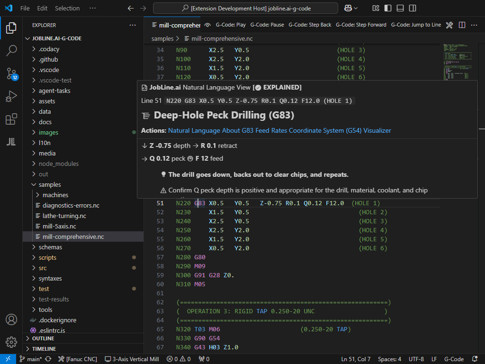
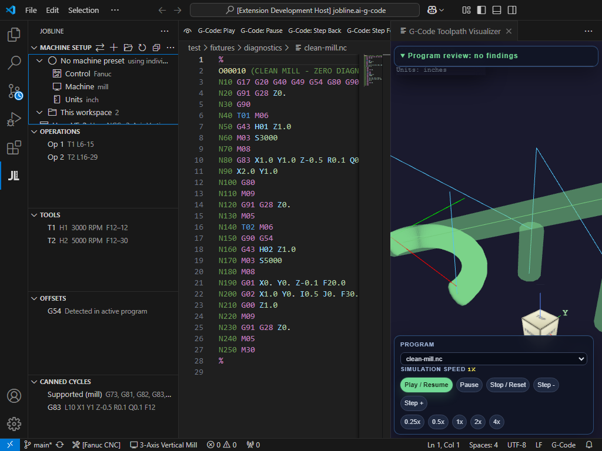
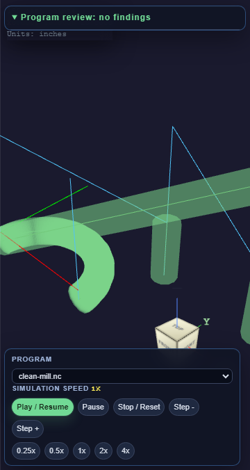

# JobLine G-Code Intelligence

G-code editing, program inspection, and 3D toolpath review in VS Code, built by **WeCr8 Solutions, LLC**.

**Current package: 0.3.12.** Includes live diagnostics, formatting, a machining toolbox, plain-language explanations, and a visualizer with stock, tools, fixtures, and target models. See [release notes](CHANGELOG.md).

## Get started

Requires **VS Code 1.85 or newer**. To install a local release, run **Extensions: Install from VSIX...** and select `jobline-gcode-0.3.12.vsix`.

1. Open an NC program, such as a `.nc`, `.gcode`, `.ngc`, `.tap`, or `.cnc` file.
2. Run **JobLine: Switch Machine** (or click the machine in the status bar) and pick or create a machine preset. It is remembered, so you only do this again when a program is meant for a different machine.
3. Open the **JobLine** Activity Bar panel to inspect operations, tools, offsets, cycles, probing, macros, and warnings.
4. Run **Show Toolpath Visualizer** or **JobLine: Open Simulation Full Window** to review the path.
5. Use **JobLine: Format G-Code** or the **JobLine Toolbox** commands to edit the program.

Additional built-in file associations are listed in [package.json](package.json). Use `jobline.additionalExtensions` for shop-specific extensions.

## Current features

| Area | Available behavior |
| --- | --- |
| Editor | Syntax highlighting, reference hover cards, formatting, and live diagnostics |
| Inspection | Operations, tools, work offsets, canned cycles, probing, macro/control-flow views, and plain-language explanations |
| Toolbox | Insert/remove/renumber N-lines; comment and block-skip edits; feed/spindle scaling; axis shifts; program header/end helpers |
| Toolpath | Linear and circular paths, G17/G18/G19 planes, G20/G21 units, G90/G91 coordinates, playback/step/seek controls, and source-line navigation |
| Scene | Stock settings, tool/holder visuals, multiple model roles, camera presets, visibility, opacity, and color controls |
| Imports | STL geometry, tessellated STEP target geometry, and Fusion F3D setup metadata/model dimensional reference |
| Repository tools | G-code review, fixture review, and manufacturing-pipeline checks |

**Validate Program** reruns the live diagnostic engine for the active G-code file, reports error and warning counts, and opens Problems. The formatter applies configured spacing, case, and decimal rules to the current document. The visualizer lets you inspect the parsed toolpath and scene before running a program on a machine; it is a review aid, not collision certification.

### In the editor

CNC control choices are **Fanuc, Haas, Siemens, Mazak, and Okuma**. **Fanuc Robot TP/LS** and **ABB RAPID** also have language/control entries. Coverage varies by dialect and program type; these entries do not imply complete controller emulation or robot kinematics.

The sidebar includes Machine Setup, Operations, Tools, Offsets, Canned Cycles, Probing, Macros & Flow, Toolbox, Alarms & Warnings, Commands, and Visualizer Settings.

## Machine presets

A machine preset holds what JobLine needs to evaluate a program for one machine: control dialect and model, machine type, units, axis travel, spindle limit, options (4th/5th axis, live tooling, probing, sub-spindle…), workholding and the CAM post id. Choose it once and every program you open is read against it.

- **Machine Setup** (top of the JobLine sidebar) shows the active machine and every preset. Click a preset to use it in this workspace; the star sets it as the default for all workspaces. Right-click to edit, duplicate, export or delete.
- **JobLine: New Machine Setup** walks through name, control, machine type, units and travel (`X30 Y16 Z20`), then saves and applies the preset.
- The status bar shows the active machine; click it to switch. The Visualizer Settings panel has the same picker.
- If a program does not fit the active machine — turning codes on a mill, rotary moves on a 3-axis, a robot program on a CNC control — JobLine offers to switch or set up a new machine. Turn this off with `jobline.presets.warnOnMismatch`.

Presets are `.jblmachine` files, the machine file format of **jobline.ai-CAM**, and the same files work in both. JobLine finds them in:

| Where | Use it for |
| --- | --- |
| Any `*.jblmachine` in the workspace (e.g. `.jobline/machines/`) | Machines that belong to a job; commit them with the programs |
| `jobline.presets.sharedFolders` | A shop network share everyone reads |
| `jobline.presets.libraryPath` (default `~/.jobline/machines`) | Your own presets — jobline.ai-CAM uses the same default folder |
| Built-in | Starting points for each supported control; edit one to make a copy |

When two places hold the same preset id, the workspace copy wins, then shared folders, then your library. Opening a `.jblmachine` file gives completion and validation from [schemas/jblmachine.schema.json](schemas/jblmachine.schema.json). Examples are in [samples/machines](samples/machines).

Applying a preset sets `jobline.machinePreset`, `jobline.controlType`, `jobline.machineType`, `jobline.units` and `jobline.detectedMachineType` in workspace settings, or in user settings when it is the default. The one-off **Select Control Type** / **Select Machine Type** commands still work; the sidebar marks a preset value you have overridden that way.

## Visualizer and imports

Use **G-Code: Import Target Model** to add reference geometry. Scene roles distinguish target parts, fixtures, jaws, holders, and tools. Fusion setup import supplies stock/model dimensions and setup metadata; its dimensional reference is not a complete reconstruction of the CAD solid. STEP imports use a bundled OpenCascade JavaScript/WebAssembly runtime.

Version 0.3.12 fixes full-circle G02/G03 moves whose endpoints are omitted and preserves milling G73 X coordinates instead of treating them as lathe diameters. The motion regression matrix covers three planes, both unit systems, absolute/incremental coordinates, and circle diameters of 2 and 1.25.

Playback is available, but smooth time-based G00/G01 interpolation remains open work. Rendering a path does not establish that a pocket or hole has been accurately simulated as removed material.

## Tool libraries, CAM output and per-control checks

- **JobLine: Import Tool Library** reads a Fusion tool library (`.json`, or `.tools`), an HSMWorks / Inventor CAM `.hsmlib`, or a CSV with a header row (`T, H, D, diameter, flute length, gauge length, description`; common spellings and Fusion CSV export headers are matched). The Tools view then shows the library data beside each tool and Problems lists tools that are not in the library, T/H and T/D register mismatches, and comment diameters that disagree with the library.
- **CAM integrations are file-based.** JobLine recognises ESPRIT, Mastercam, Fusion/HSM, GibbsCAM, Hexagon, SolidCAM, NX, CAMWorks and slicer output from the program header, reads the tool list a post writes into header comments, and reads the tool table from an exported setup sheet (HTML, XML or CSV) with the same name in the same folder. **JobLine: Watch CAM Output Folder** offers to open new posts. None of them talks to a running CAM session or reads native part files; that needs each vendor's licensed SDK. **JobLine: CAM Integrations** lists what each one reads.
- **Per-control validation.** Fanuc, Haas NGC, Siemens 840D, Okuma OSP, Mazak EIA/ISO, Mitsubishi M8/M80, Heidenhain TNC (Klartext and ISO), Fadal and generic/LinuxCNC each get their own rules on top of the shared ISO checks: G-code lists, macro / parameter syntax and ranges, loop and jump targets, subprogram calls, program-number length and M-codes per block. Unknown G-codes are information only, because options differ by machine.
- **JobLine: Convert Program to Another Control** rewrites common codes from an ISO (Fanuc-family) program to Haas, Mazak, Mitsubishi, Siemens 840D, Okuma OSP or Heidenhain Klartext, opens the result in a new tab and lists what it changed. Anything it can't map with confidence (macros, tapping/boring cycles, reference returns on OSP) is left as a `JL MANUAL` comment. It is not a CAM post-processor.

## Common commands

Open the Command Palette and search for **JobLine**, **G-Code**, or **Toolpath**.

| Command | Purpose |
| --- | --- |
| JobLine: Switch Machine | Pick the machine preset for this workspace |
| JobLine: New Machine Setup | Create and apply a machine preset |
| JobLine: Import Machine Preset (.jblmachine) | Add presets from jobline.ai-CAM or a share |
| JobLine: Select CNC / Robot Control Type | One-off control dialect override |
| JobLine: Select Machine Type (one-off) | One-off machine type override |
| JobLine: Format G-Code | Format the active program |
| JobLine: Validate Program | Rerun diagnostics, show counts, and open Problems |
| JobLine: Open Plain Language Explanation | Explain program operations |
| JobLine: Import Tool Library (Fusion .json/.tools, .hsmlib, CSV) | Check programs against your tool list |
| JobLine: Link CAM Setup Sheet to Program | Use a setup sheet's tool table for this program |
| JobLine: Watch CAM Output Folder | Offer to open new programs your CAM posts |
| JobLine: CAM Integrations | What each CAM integration reads and doesn't |
| JobLine: Convert Program to Another Control | Rewrite common codes for another control |
| Show Toolpath Visualizer | Open the 3D view |
| G-Code: Open Program in Visualizer | Select a program for review |
| G-Code: Import Target Model | Import reference geometry |
| G-Code: Play / Pause / Stop | Control playback |
| G-Code: Step Forward / Step Back / Jump to Line | Navigate the path |
| JobLine Toolbox: Insert Line Numbers / Remove Line Numbers / Renumber Lines | Apply explicit numbering edits |

## Settings

Find these under **Settings → JobLine G-Code**.

| Setting | Default | Purpose |
| --- | --- | --- |
| `jobline.machinePreset` | `""` | Active machine preset id (user value = default for all workspaces) |
| `jobline.presets.libraryPath` | `""` | Your preset folder; empty = `~/.jobline/machines` |
| `jobline.presets.sharedFolders` | `[]` | Extra `.jblmachine` folders, e.g. a shop share |
| `jobline.presets.warnOnMismatch` | `true` | Offer to switch when a program does not fit the machine |
| `jobline.controlType` | `fanuc` | CNC or robot dialect (fanuc, haas, siemens, mazak, okuma, mitsubishi, heidenhain, fadal, generic, fanuc-robot, abb) |
| `jobline.machineType` | `mill` | Machine profile |
| `jobline.units` | `inch` | Default units; G20/G21 can override |
| `jobline.additionalExtensions` | `[]` | Extra G-code file extensions |
| `jobline.validation.enableSafetyChecks` | `true` | Enable safety-related diagnostic rules |
| `jobline.validation.enableArcValidation` | `true` | Check arc geometry |
| `jobline.validation.arcTolerance` | `0.001` | Arc tolerance in current units |
| `jobline.validation.controlSpecificRules` | `true` | Run the selected control's own rule set |
| `jobline.cam.watchFolders` | `[]` | Folders your CAM posts into |
| `jobline.cam.autoLinkSetupSheets` | `true` | Link a same-name setup sheet when a program opens |
| `jobline.formatter.wordSpacing` | `true` | Separate words with spaces |
| `jobline.formatter.decimalPlaces` | `null` | Preserve decimals unless configured |
| `jobline.formatter.uppercaseGM` | `true` | Uppercase G/M codes |
| `jobline.ui.showLinks` | `true` | Show the optional Founding Shop sidebar and Academy hover links |

## Known limitations and next work

- Automatic N-number maintenance while typing is not integrated. Explicit insert/remove/renumber commands are available.
- Reported persistent green cutting color during air rapids and tool-size reset after switching large/small programs still need targeted fixes and rendered regression tests.
- Smooth linear playback and cutout/material-removal accuracy remain under development.
- Per-control rules check syntax and structure, not execution: macros and subprograms are not run, and cycle parameters are checked for presence, not machine limits. Rotary and robot motion need broader coverage. Tests use JobLine-written fixtures, not programs certified on each control.
- Machine connectivity/DNC remains planning work, not a shipped transfer feature.

### Roadmap

- Optional JobLine account sign-in to connect activity with a [free talent profile](https://jobline.ai/talent).
- Send a reviewed program and tool list to a shop job or work order, with a recorded revision and sender.
- Machine Connect for controlled transfer and shop-floor feedback; no machine transfer is included in this release.

The preview and diagnostics support program review; they are not machine collision certification.

## Development and verification

See [SETUP.md](SETUP.md) for installation, debugging, test commands, and packaging. The [feedback matrix](docs/testing/USER_FEEDBACK_MATRIX.md) distinguishes parser checks from rendered behavior and remaining gaps.

For the 0.3.12 working tree verified on **2026-10-11**, `npm run test:all` passed, including the 75-case motion matrix. The private RevGrips visual E2E verified target selection, manual placement, and ViewCube presets; its Parasolid target is still a bounds envelope rather than a tessellated solid. These checks cover those fixtures, not every machine or reported issue.

## Feedback and project information

Report problems through [GitHub Issues](https://github.com/WeCr8-Solutions/jobline.ai-g-code/issues). Include the extension version, controller and machine type, units, a minimal NC example, expected behavior, and a screenshot or recording for visual problems. Include relevant model/tool dimensions for import or sizing problems.

Learn or practice codes in [G-Code Academy](https://jobline.ai/resources/gcode-academy?utm_source=vscode), or create a [free JobLine talent profile](https://jobline.ai/talent?utm_source=vscode). The extension runs locally; it does not send program contents to JobLine. Optional links open only when selected.

- [Changelog](CHANGELOG.md)
- [Contributor setup](SETUP.md)
- [Current test coverage and gaps](docs/testing/USER_FEEDBACK_MATRIX.md)
- [Integration review](docs/JOBLINE_INTEGRATION_REVIEW.md)

Extension code is MIT-licensed; bundled dependencies retain their own licenses. The STEP runtime includes OpenCascade/occt-import-js license notices.
